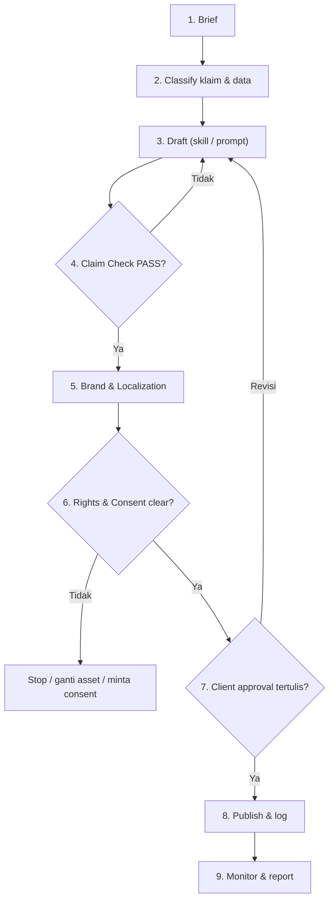

# CLAU Mandatory Content Workflow

Setiap konten untuk client — caption, video script, listing OTA, balasan review, campaign, visual — WAJIB melewati alur ini. Langkah boleh diringkas untuk konten risiko rendah, tetapi **tidak boleh dilewati**: Claim Check (4), Rights & Consent (6), dan Approval (7).

## Alur

```text
1 Brief → 2 Classify → 3 Draft → 4 Claim Check → 5 Brand & Localization
→ 6 Rights & Consent → 7 Approval → 8 Publish → 9 Monitor & Report
```



## Step 1 — Brief

**Input:** [templates/content-brief.md](./templates/content-brief.md) (validasi struktur: [schemas/content-brief.schema.json](./schemas/content-brief.schema.json)).

Wajib jelas:

- client (kode internal), vertical, lokasi umum;
- objective (awareness / engagement / direct booking / reservation / walk-in);
- target audience (domestik / mancanegara / segmen spesifik);
- channel & format;
- offer/promo (bila ada) + periode + syarat;
- sumber evidence yang tersedia;
- approver dan deadline.

**Brief sanity check (wajib):** cek kecocokan strategi sebelum drafting.

| Cek | Pertanyaan | Contoh masalah |
|---|---|---|
| Kapasitas ↔ segmen | Apakah ukuran properti/outlet cocok dengan segmen target? | Villa 5 kamar ditarget ke 1 pasangan |
| Harga ↔ segmen | Apakah harga/paket masuk akal untuk segmen & asal audiens? | Paket premium ditarget ke backpacker |
| Objective ↔ channel & format | Apakah channel/format bisa mencapai objective? | Objective direct booking, tapi hanya Stories tanpa link |
| Positioning ↔ bukti | Apakah positioning (mewah, eco, family) punya dasar di fact sheet? | "Villa mewah" tanpa standar tertulis |
| Nama brand ↔ fakta | Apakah nama menyiratkan klaim yang belum terbukti? | "Sunset" tanpa field check sunset |
| Aset ↔ consent | Apakah aset dengan orang punya consent? | Klip pasangan tanpa consent |

Setiap ketidakcocokan dicatat sebagai **RISK** + **CLIENT CONFIRMATION** di brief (`risks`, `next_actions`). Drafting boleh lanjut dengan angle sementara yang ditulis eksplisit; publish menunggu keputusan owner.

**Gate:** brief tanpa objective, channel, atau approver → kembali ke requester.

## Step 2 — Classify

- Daftar semua klaim yang akan dipakai (fasilitas, lokasi, harga, rating, sertifikasi, menu, treatment).
- Beri label: **DATA FINAL** / **ASSUMPTION** / **CLIENT CONFIRMATION** / **FIELD VERIFICATION** / **RISK** / **NEXT ACTION**.
- Tentukan 4 axis data: Sensitivity, Lifecycle, Scope, Evidence ([rule 09](./rules/09-DATA-CLASSIFICATION.md)).
- Klaim selain **DATA FINAL** tidak masuk draft, atau masuk dengan placeholder `<KONFIRMASI: ...>`.

## Step 3 — Draft

- Pilih skill atau prompt yang sesuai (index di [README.md](./README.md)).
- Ikuti brand voice client ([rule 03](./rules/03-CLIENT-BRAND-VOICE-STANDARD.md)) dan format platform ([rule 05](./rules/05-PLATFORM-STANDARD.md)).
- Hasilkan 2–3 varian bila diminta brief.
- Visual AI: ikuti [rule 07](./rules/07-AI-VISUAL-DISCLOSURE-STANDARD.md) dan beri tanda `AI-GENERATED` di file deliverable.

## Step 4 — Claim Check

**Gate:** [qa/claim-verification.md](./qa/claim-verification.md).

- Setiap klaim di draft dicocokkan dengan tabel klaim.
- Superlatif ("terbaik", "paling", "nomor 1", "best") dihapus kecuali ada bukti yang bisa ditunjukkan.
- Harga/promo: periode, syarat, dan status pajak/service charge tertulis.
- Klaim sensitif (halal, rating bintang, sertifikasi, kesehatan) → [rule 02](./rules/02-HOSPITALITY-CLAIM-STANDARD.md).

Gagal satu klaim kritis = kembali ke Step 3.

## Step 5 — Brand & Localization

**Gate:** [qa/content-review.md](./qa/content-review.md).

- Voice, diksi, dan do/don't brand client terpenuhi.
- Bahasa: ejaan EYD untuk Bahasa Indonesia formal; English natural, bukan terjemahan literal ([rule 06](./rules/06-LOCALIZATION-BAHASA-STANDARD.md)).
- Budaya & agama: tidak ada penggunaan simbol/upacara yang tidak hormat.
- Visual AI direview dengan [qa/visual-ai-review.md](./qa/visual-ai-review.md).

## Step 6 — Rights & Consent

**Gate:** [qa/privacy-rights-review.md](./qa/privacy-rights-review.md).

- Foto/video: pemilik hak jelas (client, fotografer berlisensi, stock berlisensi).
- Tamu/staf/talent yang terlihat jelas: consent tercatat di consent register client.
- Repost UGC: izin dari pemilik akun tercatat; credit sesuai permintaan.
- Musik: memakai library platform yang sah untuk akun bisnis, atau lisensi tercatat.
- Endorsement/kolaborasi berbayar: disclosure siap ([rule 05](./rules/05-PLATFORM-STANDARD.md)).

Gagal → stop, ganti asset, atau minta consent. Tidak ada exception tanpa approval owner.

## Step 7 — Approval

**Gate:** [rule 08](./rules/08-APPROVAL-PUBLICATION-STANDARD.md) + [templates/approval-record.md](./templates/approval-record.md).

- Approval tertulis dari approver yang ditunjuk di onboarding.
- Approval mencakup: teks final, visual final, channel, tanggal publish.
- Perubahan setelah approval = approval ulang untuk bagian yang berubah.
- Creator tidak boleh self-approve konten dengan klaim, promo, data tamu, atau konten berbayar.

## Step 8 — Publish

**Gate:** [qa/publication-checklist.md](./qa/publication-checklist.md).

- Publish oleh publisher berwenang (manusia, atau scheduler yang dijalankan manusia).
- Catat: URL post, waktu publish, versi yang dipublish.
- AI tidak publish secara mandiri.

## Step 9 — Monitor & Report

- Pantau komentar/DM 24–72 jam pertama; eskalasi komplain serius.
- Koreksi cepat bila ada kesalahan: edit/unpublish sesuai otoritas, catat insiden.
- Report bulanan: [templates/monthly-report.md](./templates/monthly-report.md). Metrik dilaporkan apa adanya dari platform insight — tidak dibulatkan ke atas, tidak dikarang.

## Mode SIMULASI (pilot & contoh)

Dipakai untuk menguji alur dengan properti fiktif (lihat [examples/](./examples/README.md)) atau melatih tim. Mode ini **tidak pernah** menghasilkan konten yang boleh dipublish.

| Aturan | Isi |
|---|---|
| Penanda wajib | Kata **SIMULASI** di judul/catatan setiap dokumen (brief, draft, QA, approval record); nama properti mengandung "Contoh" |
| Data | Hanya data fiktif. Dilarang memakai data, foto, atau nama client/tamu nyata |
| Langkah wajib | 1–6 dijalankan penuh: brief, classify, draft, claim check, brand & localization, rights & consent |
| Langkah 7 (Approval) | Diisi di [approval record](./templates/approval-record.md) dengan `Mode: SIMULASI`, dan keputusan selalu "SIMULASI — tidak ada approval nyata" |
| Langkah 8–9 | **Tidak dijalankan.** Publication checklist boleh di-*pre-check* untuk menemukan blocker, tapi tidak boleh publish, schedule, atau boost |
| Promosi ke nyata | Konten simulasi tidak bisa "dinaikkan" jadi konten client. Untuk client nyata, mulai ulang dari Step 1 dengan brief dan fact sheet nyata |

## Final QA Gate (hard stop)

Konten **tidak boleh** publish bila salah satu ini terjadi:

- [ ] Ada klaim non-**DATA FINAL** di teks/visual publish.
- [ ] Ada harga/promo tanpa periode, syarat, atau status pajak/service.
- [ ] Ada data/foto tamu tanpa consent tercatat.
- [ ] Ada visual AI yang bisa dikira foto asli properti.
- [ ] Ada klaim kesehatan/medis spa.
- [ ] Ada konten berbayar tanpa disclosure.
- [ ] Approval tertulis belum ada.
- [ ] Dokumen berstatus **SIMULASI**.

## Revision History

| Version | Date | Status | Summary |
|---|---|---|---|
| 0.1.0 | 2026-10-03 | Draft | Initial mandatory workflow 9 langkah |
| 0.1.1 | 2026-10-03 | Draft | Seragamkan metadata (owner, classification, format revision history) |
| 0.1.2 | 2026-10-04 | Draft | Tambah Mode SIMULASI untuk pilot & contoh (TASK-017) |
| 0.1.3 | 2026-10-04 | Draft | Tambah brief sanity check di Step 1 (TASK-023) |
