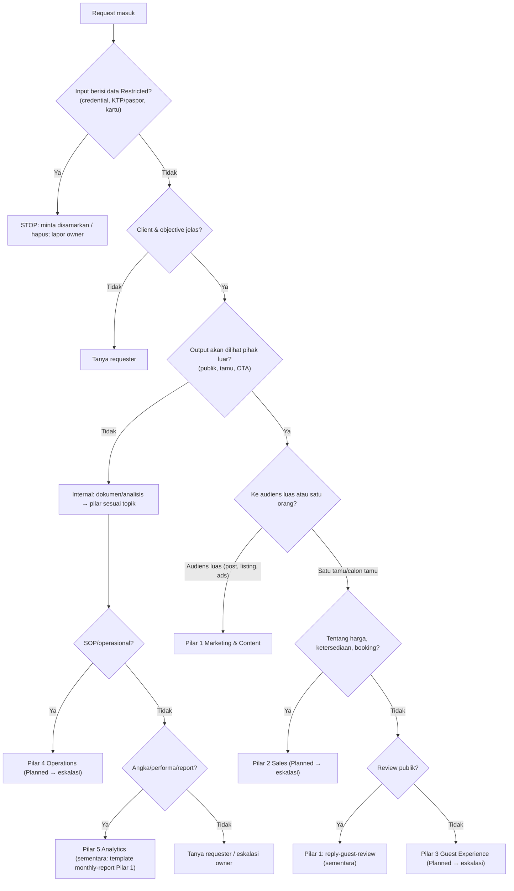

# Decision Tree

Dipakai saat intent tidak langsung jelas dari [router.md](./router.md).

## Pertanyaan Tambahan Setelah Pilar Ditentukan

1. Ada harga, promo, atau komitmen komersial? → approval minimal L2; komitmen baru → eskalasi.
2. Ada orang yang dapat dikenali di aset? → cek consent sebelum produce.
3. Menyentuh agama/adat/tempat suci, bencana, atau isu sensitif? → L3 + eskalasi.
4. Keluhan serius tamu (keracunan, cedera, pelecehan, kehilangan, ancaman hukum)? → jangan draft balasan final; eskalasi L3.
