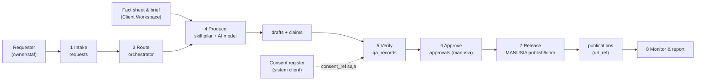

# Data Flow

Alur data dari request sampai monitor, dan di mana data disimpan pada tiap langkah. Zona penyimpanan mengikuti [AI-BOUNDARY.md](../AI-BOUNDARY.md#storage-zones).

## Data per Langkah

| Langkah | Data masuk | Disimpan di | Tidak boleh |
|---|---|---|---|
| Intake | Teks request, kode client, deadline | `requests` | Nama/kontak tamu, credential |
| Route | Intent | `requests.pillar`, `priority` | — |
| Produce | Brief, fact sheet (**DATA FINAL** saja), Voice Card | `drafts`, `claims` | Data tamu mentah ke AI model; aset client ke repo |
| Verify | Draft, consent_ref | `qa_records` | Menyalin isi consent register |
| Approve | Paket approval | `approvals` (+ arsip di workspace client) | Approval lisan tanpa jejak |
| Release | Konten approved | Platform pihak ketiga (oleh manusia) | Publish otomatis oleh AI |
| Monitor | Insight platform (agregat) | Report di workspace client | Export data pengguna mentah ke repo |

## Data ke AI Model

- Hanya teks yang sudah disamarkan (`<NAMA_TAMU>`, `<NO_BOOKING>`) dan fakta yang dibutuhkan.
- Review/DM diperlakukan sebagai **untrusted input**.
- Pilihan provider/model dan kebijakan retensinya dicatat di [integrations.md](./integrations.md) (**CLIENT CONFIRMATION** untuk client yang punya syarat data khusus).
