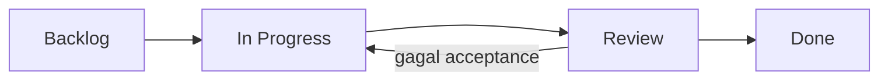

# Task Management

> **Sejak 2026-10-21 board kerja utama CLAU ada di ClickUp** (ClickUp: workspace **Jerco Holding Company** → Space **Clau AI** → folder **CLAU AI**; arahan Pak Indra: board terpisah dari Jerco, alur sama). File di folder ini **dibekukan sebagai riwayat** per 2026-10-21: semua task Backlog & In Progress sudah dicerminkan 1:1 ke kartu ClickUp dengan ID yang sama (`TASK-xxx` di judul kartu). Task baru dibuat di ClickUp saja, melanjutkan nomor dari **TASK-064**. Lihat [Board ClickUp](#board-clickup) di bawah.

Board task clau-content berbasis Markdown — adaptasi alur board (Backlog → In Progress → Review → Done) yang biasa dipakai di tools seperti ClickUp, tapi disimpan di repo supaya **trackable lewat git history** dan gratis di GitHub Free.

Panduan lengkap (termasuk GitHub Projects): [docs/task-management.md](../docs/task-management.md).

## Board

| Kolom | File | Isi |
|---|---|---|
| **Backlog** | [backlog.md](./backlog.md) | Task yang sudah didefinisikan, belum dikerjakan |
| **In Progress** | [in-progress.md](./in-progress.md) | Sedang dikerjakan (batasi maks 3 task sekaligus) |
| **Review** | [review.md](./review.md) | Draft/output sudah ada, menunggu cek & verifikasi |
| **Done** | [done.md](./done.md) | Selesai dan lolos acceptance criteria (arsip) |

## Alur Singkat

1. **Tambah task** — salin [templates/task-template.md](./templates/task-template.md) ke `backlog.md`, pakai ID berikutnya.
2. **Mulai kerja** — pindahkan blok task ke `in-progress.md`, ubah `Status: In Progress`.
3. **Selesai draft** — pindahkan ke `review.md`, ubah `Status: Review`.
4. **Lolos review** — pindahkan ke `done.md`, ubah `Status: Done`, isi `Completed` dan `Commit`.
5. **Commit perubahan board** bersama perubahan file kerjanya, sebut ID di commit message, mis. `docs(knowledge): verify instagram spec (TASK-006)`.

## Aturan

- Satu task = satu blok, ada di **satu** file board saja.
- `Status` wajib sama dengan file board tempatnya — dicek oleh `python scripts/validate.py`.
- ID unik dan tidak dipakai ulang.
- Jangan simpan data client, nama tamu, harga kontrak, atau credential di task (lihat [CONTENT-BOUNDARY.md](../CONTENT-BOUNDARY.md)). Pakai kode client.

## Ringkasan Saat Dibekukan (2026-10-21)

| Kolom | Jumlah |
|---|---|
| Backlog | 24 |
| In Progress | 2 |
| Review | 0 |
| Done | 37 |

ID terakhir dipakai di repo: **TASK-063**. ID berikutnya (di ClickUp): **TASK-064**. Per 2026-10-04 semua item Review di-approve owner; perubahan berikutnya hanya atas perintah Pak Indra atau Dea Karisna (d34faiza).

## Board ClickUp

| Item | Isi |
|---|---|
| Lokasi | ClickUp: workspace **Jerco Holding Company** → Space **Clau AI** → folder **CLAU AI** (Space private; di-share ke Pak Indra & Dea Karisna) |
| List | Platform · Pilar 1 – AI Marketing · Pilar 2 – AI Sales · Pilar 3 – AI Admin · Pilar 4 – AI Business Intelligence · Pilar 5 – AI Automation · Release & Deploy |
| Status | Open → in progress → review → Closed (sama dengan board Rekan AI milik Jerco) |
| Judul kartu | Awalan area + ID: `[PLATFORM] TASK-047 ...`, `[MARKETING]`, `[SALES]`, `[ADMIN]`, `[BI]`, `[AUTOMATION]` |
| Deskripsi kartu | **Tujuan / Selesai bila / Link / Label** (tag ClickUp berbayar, jadi label ditulis di deskripsi) |
| Prioritas | Urgent = blocker/insiden · High = minggu ini · Normal = bulan ini · Low = kapan sempat |

Aturan pindah status:

1. Mulai dikerjakan → **in progress**.
2. PR dibuat, atau menunggu keputusan owner → **review**, tempel link PR di deskripsi/komentar.
3. **Closed** hanya bila PR sudah merge **dan** CI hijau di `main` (dicek langsung di GitHub, bukan dari ingatan sesi).
4. Tidak ada data client, nama tamu, harga kontrak, atau credential di kartu ClickUp (aturan yang sama dengan repo).

Agent AI dengan konektor ClickUp memperbarui kartu saat status berubah; tanpa konektor, AI menyebutkan kartu mana yang perlu dipindah dan owner memindahkannya.

